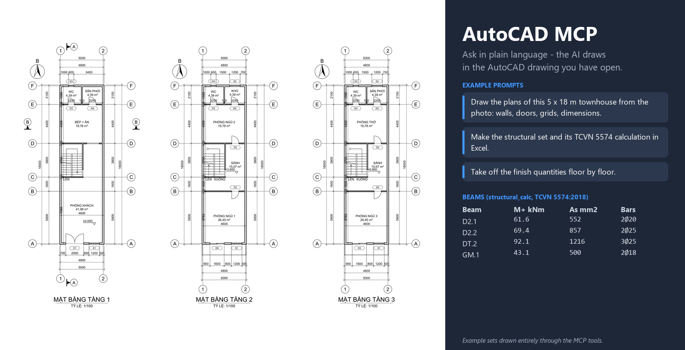

# AutoCAD MCP

**English** | [Tiếng Việt](README.vi.md)



AutoCAD MCP lets Claude work directly in the drawing you have open in AutoCAD. Its main job is drafting: from a scanned or photographed plan, a sketch, a render or a 3D model, Claude draws a complete, layered 2D drawing (walls with clean junctions and material hatches, doors and windows cut into the walls, columns, grids with bubbles, stairs, rooms with measured areas, dimension chains, symbols, a sheet with a title block and a PDF). From the same plan it derives the elevations and sections, draws reinforced-concrete details (beams, columns, footings) with their bar schedule, and the interior design set: furniture layout, floor finish and ceiling plans, interior elevations of each wall, joinery shop drawings and the finish schedule. It also reads drawings, takes off quantities by layer and block, and checks drawings for common problems.

It works like [SketchUp MCP](https://github.com/2ez4gcx/sketchup-mcp): a Claude Desktop extension (`.mcpb`) that runs on the Node.js built into Claude Desktop, plus a small add-in that runs inside AutoCAD (the **ACAD MCP Bridge**, a .NET add-in). No Python or Node.js install is needed.

Current version: **1.2.0** - [download it from Releases](https://github.com/2ez4gcx/autocad-mcp/releases/latest). Also listed in the official [MCP Registry](https://registry.modelcontextprotocol.io/v0.1/servers?search=io.github.2ez4gcx/autocad-mcp) as `io.github.2ez4gcx/autocad-mcp`.

## Features

53 tools. Lengths are in drawing units (mm in a metric drawing), areas in m², angles in degrees counter-clockwise from +X.

| Group | Tools |
|---|---|
| Read & quantities | `ping`, `drawing_info`, `list_layers`, `list_blocks`, `query_entities`, `selection_info`, `quantity_takeoff`, `check_drawing` |
| Standards | `setup_layers`, `setup_styles` |
| Drawing & editing | `draw_plan`, `draw_entities`, `define_block`, `transform_entities`, `set_properties`, `delete_entities`, `select_entities`, `undo`, `purge_drawing` |
| Elevations, sections & structure | `draw_elevation`, `draw_section`, `draw_roof_plan`, `draw_door_schedule`, `draw_stair_detail`, `draw_finish_quantities`, `draw_structure_plan`, `draw_beam_schedule`, `draw_structure_notes`, `draw_structure_detail`, `rebar_schedule`, `structural_calc`, `draw_quantity_schedule` |
| Interior design | `draw_furniture_plan`, `draw_floor_finish_plan`, `draw_wall_finish_plan`, `draw_ceiling_plan`, `draw_interior_elevation`, `draw_joinery_detail`, `material_schedule` |
| Images & 3D sources | `view_image`, `attach_image`, `import_drawing`, `screenshot`, `set_view` |
| Sheets & files | `create_layout`, `draw_cover_sheet`, `draw_drawing_list`, `export_pdf`, `save_drawing`, `open_drawing`, `new_drawing` |
| Scripting | `run_lisp` |
| Setup | `install_autocad_bridge` |

Highlights:

- **Asks before it assumes**: before drawing, Claude lists what the request leaves open (dimensions it cannot read, heights, roof, materials, furniture, structural sizes...) with the value it would use, and draws once you confirm or change them. `draw_plan`, `draw_elevation`, `draw_section`, `draw_structure_detail` and the interior drawing tools take `dry_run=true` to list the defaults they would apply without drawing, and every result reports the defaults it used (`assumed`).
- **A complete plan in one step** (`draw_plan`): Claude describes the plan in millimetres, as read from the image (wall axes and thicknesses, openings by wall and offset, columns, grids, rooms, stairs, levels, section marks, north arrow) and the tool draws it all in one Undo step:
  - walls are unioned, so L, T and X junctions come out clean, with a different hatch per material (brick, concrete, block, light, stone, solid);
  - doors (single, double, sliding), windows and plain openings are cut out of the walls, with leaf, swing arc and glazing lines;
  - columns are cut out of the walls and hatched; a column can be placed at every grid intersection;
  - grids get bubbles at both ends (1, 2, 3... across, A, B, C... up), exterior dimension chains (openings, grid spacing, overall size) are added on the sides you choose;
  - **room areas are measured from the walls, never typed**: each room is a point inside it; the label shows the name and the measured area (a name wider than the room is wrapped onto two lines and the label kept off the walls), a closed boundary goes on `A-AREA` (not plotted) for takeoffs, and spaces closed by walls but without a room are reported.
- **Elevations and sections from the plan** (`draw_elevation`, `draw_section`): built from the same description as `draw_plan`, so they always agree with it. Heights (floor, ground, wall top, door heads, window sills and heads, foundation) and roofs (gable with either ridge direction, pitch, overhang, or flat with parapets; several roofs, e.g. a porch) are given once.
  - elevations from any side: the nearest walls and columns win, hidden lines are removed, roofs show the eaves side (tile ribs) or the gable end, doors and windows with frames, plinth and ground lines, level marks, height dimension chains, grid bubbles with their spacing, title;
  - sections along the plan's section mark (or any cut line): slabs, roof slabs, lintels and the beams under the slabs on every cut wall drawn solid (poché, `beam_depth` default 300), cut walls hatched with lintels over the openings they cross, each room's ceiling at its finish level with its drop bands and hangers up to the slab and its ceiling and floor codes, level marks on both sides tied to the building by extension lines, footings with lean concrete, floor slab and fill, a porch slab out to its columns, the roof cut, walls, doors and windows seen beyond, room names, levels and grids;
  - ornaments seen in a photo (gable windows, cladding, finials) are added with `draw_entities` on `A-ELEV`.
- **Three sets, three files**: architecture (KT), structure (KC) and interior (NT) are separate drawings, as a design office issues them. Each is made with `new_drawing` from the same plan description and has its own drawing list (`draw_drawing_list`, sheet KT-00 / KC-00 / NT-00), sheet numbers and title block item (KIẾN TRÚC, KẾT CẤU, NỘI THẤT). The structural and interior tools work in a file without the architectural plan: AutoCAD computes the room outlines from the plan description without drawing it (`draw_plan rooms_only`). Example: `examples/Nha-pho-5x18-KT.pdf`, `-KC.pdf`, `-NT.pdf`.
- **Roof plan** (`draw_roof_plan`), for flat roofs:
  - the parapets and the stair tower of the top floor, with grids and dimensions;
  - the tower roof hatched, the roof terrace;
  - floor drains with falls (i=2%) and rainwater pipes;
  - the levels of the terrace, the parapet top and the tower roof;
  - notes on waterproofing, screed to falls and pipes.
- **Cover sheet** (`draw_cover_sheet`): "HỒ SƠ BẢN VẼ <set>", the phase, project, item, client, consultant, contractor, location, date; every set starts with its cover and its drawing list.
- **Door and window schedule** (`draw_door_schedule`):
  - every type (by tag, kind and size, on every floor) drawn in elevation with its frame, leaves and opening direction (dashed lines meet on the hinge side) and glazing;
  - its width, height and sill dimensions, its tag and count;
  - the table: tag, kind, W x H, sill, count by floor, description.
- **Stair detail** (`draw_stair_detail`), for a U stair:
  - the stair plan on each kind of floor (start, typical floors grouped, arrival) at 1:50, with the walls around it, the treads numbered, run / landing / width dimensions (n x going), floor and landing levels, grids and the section mark;
  - section 1-1 along the flights: the cut flight with its RC waist slab and landing, the flight beyond, slabs and walls cut, handrails with balusters, riser dimensions (n x riser) per flight, floor heights and levels;
  - build-up notes of treads and landing, with 2h + b;
  - the tread and handrail detail at 1:20 (granite, mortar, brick steps, waist slab, plaster, handrail, balusters), drawn apart: one sheet holds both through `create_layout views`.
- **Preliminary structural calculation** (`structural_calc`), to be checked, calculated again and signed by a licensed structural engineer:
  - loads by TCVN 2737:2023: slab build-ups, live loads by room (rooms 1.5, halls and stairs 3, balconies 2 kPa ...), partitions, walls on the beams less their openings, self-weight;
  - slab panels shared out to their beams (two-way trapezoid / triangle, one-way), continuous beams with the live load on all / odd / even spans, end supports qL²/24;
  - bending and shear by TCVN 5574:2018 (αm, ξ ≤ ξR, As, bars; stirrups at the supports and midspan); the designed bars go to `draw_beam_schedule`;
  - column loads floor by floor down to the footings (a column standing on a slab hands its load to the beam under it), column capacity, footing area for the soil pressure;
  - a sheet of tables (materials, slab loads, build-up, beams, columns and footings, assumptions) with the sign-off: calculated, checked, structural lead (name, licence No., signature, date); CSV for Excel;
  - `xlsx_path`: a live Excel workbook: the inputs in yellow cells (materials, layer thicknesses and unit weights, load factors, live loads, soil pressure, column and footing sizes, q, bars), everything else as formulas (g, p, M, αm, ξ, As, checks, stirrup spacing, column capacity, footing area), so it calculates again when a value changes.
- **Bar schedule and bill of quantities** (`draw_quantity_schedule`):
  - the bar schedule of the whole set: footings, columns, ground beams and beams as designed, slabs and stairs by the detailing rules; laps and anchorage, weights as table formulas, totals per diameter, flowing over pages;
  - the bill of quantities with how each item is made up: lean concrete, concrete and formwork of footings, column stubs, ground beams, columns per storey, beams, slabs, stairs; steel by grade; brick walls by thickness (m², m³) less the openings; plaster inside, outside and of the soffits; CSV for Excel;
  - `xlsx_path`: the whole structural workbook (the calculation, the bar schedule with its weights as formulas, the quantities as formulas of how they are made up).
- **Architectural finish quantities** (`draw_finish_quantities`): floor tiles by finish, wall tiles, skirting; skim coat and paint inside, outside (the faces with no room on their side, plinth, parapets) and of the ceilings; gypsum ceilings; waterproofing of toilets, balconies and the roof terrace; screed to falls and the tower roof; stair granite and railings, balcony railings; doors and windows by type. The rooms and finishes are those of the interior set. A table with the quantity of every floor, CSV, and an Excel workbook with a column per floor and the total as their sum.
- **Structural set** (`draw_structure_plan`, `draw_beam_schedule`, `draw_structure_notes`):
  - `draw_structure_plan floor=foundation` draws the foundation plan: pad footings M1 under the columns (hidden), ground beams GM under the ground floor walls, the footing size and bottom level;
  - `draw_structure_plan` draws the framing plan of each slab (floor 2, 3 ... and the roof):
    - beams along the load-bearing walls of the floor below (partitions under 150 mm stand on the slab), named per slab (D2.1 ..., DM.1 for the roof) with b x h and their count;
    - columns at the wall nodes;
    - the slab thickness, wet rooms and balconies lowered 50 (hatched), stair openings crossed;
    - grids with bubbles and dimensions.

    Sizes are preliminary (h = span/12, rounded up to 50, 300-700) and reported as assumed, for the engineer to confirm.
  - `draw_beam_schedule` gives every beam type its support (GỐI) and midspan (NHỊP) sections, with the slab flange, the FL level, bars and stirrups, titled "DẦM D2.1 (200x400) - SL: 02".
  - `draw_structure_notes` draws the general notes as tables:
    - materials (B20 / B15 / B7.5, CB240-T / CB300-V);
    - concrete cover by member;
    - anchorage and lap lengths by diameter;
    - typical lintels by span;
    - numbered notes (TCVN 5574:2018 defaults, every value can be given).
- **Structural details** (`draw_structure_detail`, `rebar_schedule`): cross-sections with bars and 135° stirrup hooks, beams over several spans (bottom and top bars, support bars over a fraction of the span, dense and normal stirrup zones, sections 1-1 and 2-2), pad footings with mesh, column starter bars, ties and levels; bar marks with leaders, each different bar with its own mark. Every detail returns its schedule rows; `rebar_schedule` combines them into the bar schedule (bars, total length, weight d²/162 kg/m per row, per diameter and overall) as a table and a CSV. Sizes and bars come from the engineer: the tool draws, it does not design, and it warns when bars do not fit the clear spacing.
- **Interior design** (from the plan of `draw_plan`; material codes as in SketchUp MCP: FL floor, SK skirting, WL wall, CL ceiling, JN joinery, FN furniture, SN sanitary, EQ equipment, LT lighting, one code per specification):
  - `draw_furniture_plan`: a 1:50 copy of the plan with a furniture library (beds, nightstands, wardrobes, sofas, tables and chairs, desks, TV cabinets, kitchen base and wall cabinets with sink and hob, hood, fridge, washer, toilet, vanity, shower, bathtub, shoe cabinet, bookshelf) placed against a wall of a room by offset, code tags kept clear of each other, room names moved clear of the furniture and the door swings, elevation keys A-D;
  - `draw_floor_finish_plan`: the real tile or plank joints of each room (centred tiles or from a start point, staggered planks) kept clear of the room names, code tags and a legend with the area of each finish;
  - `draw_floor_finish_plan` also marks the details a site needs:
    - a stainless transition strip under each door where the finish or the level changes;
    - in wet rooms and outdoors, a floor drain (in the shower when there is one), the fall arrow "i=1%" and the drop (20 mm wet rooms, 50 mm outdoors);
    - how the tiles are set out (LÁT TỪ TÂM);
  - `draw_wall_finish_plan`: a band along the inside face of every wall in the pattern of its finish (one line for paint, two lines with the tile joints for tiles), broken at the doors and windows; the kitchen splashback behind the base cabinets; a code tag per room with the tiling height; the legend with the area of each wall finish;
  - `draw_ceiling_plan`: drop bands along the walls with the step line and LED cove, downlights in the band (or a grid), a ceiling lamp or a pendant over each dining table, level tags (level over code), light legend with counts. `mode=finish` gives the ceiling finish plan (materials, levels, the step widths dimensioned, ceiling legend with areas; no lights), `mode=lighting` the lighting layout (lights and their legend; no level tags);
  - every interior plan ends with its general notes (GHI CHÚ: units, site checks, material approval, and per plan: tile joints and falls, paint and tiling build-ups, board and access panels, set-out of the lights), or the notes you give;
  - `draw_interior_elevation`: each wall of a room seen from inside: cut walls, floor and ceiling (drop band), the doors and windows of the wall, the furniture and joinery backed on it (front view) and in the corners (side view) as blocks (one per type, size and view, `NT_MD_...` / `NT_MB_...`) with a wipeout under their outlines so that nearer items hide what is behind them, wall tile joints, kitchen backsplash, skirting, dimension chains and material notes with leaders;
  - `draw_joinery_detail`: kitchen run (base cabinets with doors/drawers/sink module, wall cabinet runs and hood, backsplash) or wardrobe: front at 1:10 with modules, hinge sides and handles, section 1-1 through the carcass with panel thicknesses and material notes; taken straight from a cabinet of the layout plan;
  - `material_schedule`: floors and ceilings in m², skirting in m (doors deducted), walls in m² (openings and backsplash deducted), furniture, joinery, sanitary ware, equipment and lights by count, one row per code with its rooms; table and CSV.
  Finishes default by kind of room (dry rooms porcelain 600x600, paint, gypsum ceiling with a drop band; WC anti-slip tiles, wall tiles to the ceiling, moisture-resistant ceiling; yards no ceiling) and every result lists what was assumed.
- **Buildings of several floors** (`draw_plan` with `floors`): each floor has its own walls (or keeps those of the floor below), openings, stairs, balconies, rooms and roof; floor heights default to 3600 (ground floor) and 3300, slabs 120; parapets are copied from the walls below at their own height; a U stair shows UP on the ground floor, UP/DOWN in between and DOWN on the top floor; balconies get their slab edge and railing. The floor plans are drawn side by side, the elevations and sections stack every floor (levels of each floor and parapet, balcony railings, stairwell holes in the slabs, the stair cut along its flights), and the interior tools take `floor`.
- **Blocks, fields and multileaders, not bare lines**:
  - doors, windows and sliding doors are blocks, one per size (`MCP_CUA_DI_900`, `MCP_CUA_DI_2C_1400`, `MCP_CUA_SO_1200_220`), inserted rotated or mirrored, with code, type and width attributes;
  - furniture and sanitary ware are one block per kind and size (`NT_<code>_<type>_<width>x<depth>`, attributes code, name, size);
  - lights (`MCP_DEN_*`), code tags, ceiling tags, grid bubbles, level marks, section marks, the north arrow, interior elevation keys, bar marks and the title block are blocks too, their values attributes. `quantity_takeoff group_by=block` counts them with their values, and ATTEDIT or the properties palette edits them.

  Definitions are made the first time they are used. The AutoCAD API cannot author dynamic blocks, so each size is its own definition.
  Room labels show the area as a field of the room's `A-AREA` boundary: stretch the boundary, then REGEN or UPDATEFIELD.
  The material notes of interior elevations are multileaders whose content is a tag block (code boxed, a short description under it), in a row above the elevation (floor and skirting in a row under it), dashed and in the same order as what they name, so no two cross. Joinery details keep a column of text multileaders.
  Furniture and door tags are hexagons, material tags rectangles. Every drawing is titled with an underlined name and "TỶ LỆ: 1/50".
  The material schedule table shows each item's and light's block next to its code.
- **Professional layers** (`setup_layers`): an AIA/NCS-style architectural set with lineweights for monochrome plotting and descriptions in Vietnamese or English: `S-GRID` (CENTER), `S-COLS`, `A-WALL` (0.5 mm), `A-WALL-PATT`, `A-DOOR`, `A-GLAZ`, `A-OPEN`, `A-FLOR-STRS`, `A-FURN`, `A-FLOR-FIXT`, `A-AREA` (no plot), `A-ANNO-ROOM`, `A-ANNO-TEXT`, `A-ANNO-DIMS`, `A-ANNO-SYMB`, `A-ANNO-TTLB`, `A-ANNO-NOTE`, `A-ELEV`, `A-SECT`, `A-FLOR-CASE`, `A-CLNG`, `E-LITE`, `A-DETL`, `S-CONC`, `S-REBR`, `S-REBR-STIR`, `X-IMAGE` (no plot)... A layer scheme the drawing already has is followed instead (`draw_plan` takes a role-to-layer map).
- **Styles for a plot scale** (`setup_styles`): mm units, a TrueType text style (`MCP-ARIAL`, so Vietnamese never shows as `?`), a dimension style `MCP-1-<scale>` with architectural ticks and text above the line, a multileader style, table text and LTSCALE.
- **Working from images**: `view_image` shows an image file to Claude with a crop (zoom into a detail to read dimensions) and a pixel grid with coordinates; `attach_image` puts it in the drawing as a faded underlay on `X-IMAGE`, calibrated from two pixels of a known dimension and anchored on a drawing point; `draw_entities` can take points in image pixels (`image_handle`) to trace; `screenshot` renders the drawing off screen (white background, your view is not touched) so Claude compares its work with the source.
- **From a 3D model**: read the dimensions from the model (for example with SketchUp MCP) and redraw with `draw_plan`, or `import_drawing` a 2D DWG/DXF export (plan, section, elevation) with its layers prefixed, then clean it up and annotate it.
- **Every entity type** (`draw_entities`): lines, polylines with arcs, rectangles, circles, arcs, ellipses, splines, points, text and multiline text, hatches (with islands), linear/aligned/angular/radius/diameter dimensions, dimension chains with an overall dimension, multileaders, blocks with attributes (also from a DWG file), tables. One batch is one Undo step; if one entity is wrong nothing is drawn and the error names it.
- **Editing** by handle: move, copy (repeated), rotate, scale, mirror, rectangular and polar arrays, offset (towards a point or both sides), explode (block attribute values are kept); properties, text and attribute values.
- **Quantities** (`quantity_takeoff`): per layer, block or type: counts, lengths (m), areas of closed outlines (m²), hatch areas (m²) and block counts with the tally of attribute values; CSV for Excel (`csv_format=semicolon` for Excel with Vietnamese/European regional settings: `;` separators, decimal commas).
- **Drawing QA** (`check_drawing`): stacked duplicates (they double quantities), polylines that look closed but are not, open outlines on area layers, Vietnamese text in SHX styles (shows `?`), missing fonts, unresolved xrefs and images, objects on Defpoints, typed-over dimension values, objects far from the rest, objects on layer 0, colors/linetypes/lineweights not ByLayer, layers outside the naming standard.
- **Fields**:
  - room areas are fields of the room boundaries;
  - in the finish schedule, floor and ceiling quantities are formula fields summing the room boundaries;
  - the bar schedule totals (bars, length, weight per row, per diameter, overall) are table formulas: change a count or a length in the table and the weights follow;
  - the title block's scale is a field of the viewport's scale, and its drawing number a field of the layout name.

  Decimal commas in Vietnamese.
- **Sheets** (`create_layout`, `export_pdf`): a layout on ISO A0-A4 with `DWG To PDF.pc3` and `monochrome.ctb`, a frame with ISO/TCVN margins, a title block and a locked viewport.
  - The title block on landscape A3-A0 is the vertical strip of Vietnamese construction sets: revisions, notes, client, project, item, consultant, chief of project, chief of division, designer, checker, drawing name, contract, version, phase, drawing number, scale and date, plus a general note along the bottom. `title_block.style=bottom` gives the 180 mm bottom block, which A4 and portrait sheets use. Either one is a block with attributes.
  - `views` puts several viewports on one sheet, each a model window at its own scale (a plan at 1:100 with a detail at 1:25, three floor plans side by side): packed in rows, bottoms aligned, centred in the drawing area; the title block scale then reads "NHƯ HÌNH" when the scales differ.
  - The viewport is at a standard scale fitted automatically, placed above or beside the title block, wherever the view fits (a warning if a given scale would crop it). `export_pdf` plots layouts into one multi-page PDF (layouts on different paper sizes give one PDF per size, e.g. `set_A3.pdf`, `set_A1.pdf`) or a model-space window at a scale.
- **Files** (`save_drawing`, `screenshot save_path`): DWG 2018/2013/2010/2007/2004/2000 and DXF; `copy=true` (the default for older versions and DXF) writes an export copy and leaves the open drawing as it is, otherwise Save As; PNG images of the drawing up to 4096 px.
- **`run_lisp`**: when no tool fits, Claude runs AutoLISP (results come back as JSON) as one Undo group. The code never touches the disk, so AutoCAD's SECURELOAD does not ask about it.
- **Every drawing edit is one Undo step** (`MCP_<TOOL>` in AutoCAD's Undo list).
- **AutoCAD commands**: `MCPSTATUS`, `MCPSTART`, `MCPSTOP`, `MCPPORT`, `MCPLOG`.

## How it works

```
Claude Desktop
    |  MCP over stdio
    v
autocad-mcp-1.2.0.mcpb        Node.js MCP server, runs on the Node built into Claude Desktop
    |  one JSON request per command, TCP 127.0.0.1:9877 (localhost only)
    v
ACAD MCP Bridge               .NET add-in inside AutoCAD (autoloader bundle), runs commands on AutoCAD's main thread
    |  AutoCAD .NET API
    v
the open drawing
```

The bridge runs inside AutoCAD (not over COM from outside): every command runs on AutoCAD's main thread inside one document lock, which is fast on large drawings, safe, and gives one Undo step per command.

## Requirements

- **Claude Desktop** (a current version, with *Settings > Extensions*).
- **AutoCAD 2021, 2022, 2023 or 2024** (full AutoCAD or a vertical such as AutoCAD Architecture; **not AutoCAD LT**, which cannot load .NET add-ins) on **Windows 10/11**. Tested on AutoCAD 2024. AutoCAD 2025 and later run on .NET 8 and need a bridge built for it (not included yet).
- To build from source only: Node.js 18+, the Visual Studio Build Tools C# compiler and AutoCAD 2021-2024 installed.

## Install

1. **Install the extension in Claude Desktop**: download `autocad-mcp-1.2.0.mcpb` and `AcadMcpBridge-1.2.0.bundle.zip` from the [latest release](https://github.com/2ez4gcx/autocad-mcp/releases/latest), then in *Settings > Extensions* drag and drop the `.mcpb` into the window (or *Advanced settings > Install Extension...*), click *Install*. The build is not code-signed, so Claude Desktop may warn about it.
2. **Install the bridge in AutoCAD**: in a new chat ask Claude *"Install the ACAD MCP Bridge in AutoCAD"* (tool `install_autocad_bridge`). It copies `AcadMcpBridge.bundle` into `%APPDATA%\Autodesk\ApplicationPlugins`, which AutoCAD loads at startup. Manual install: unzip `AcadMcpBridge-1.2.0.bundle.zip` into that folder.
3. **Restart AutoCAD.** The add-in is not digitally signed: when AutoCAD asks about `AcadMcpBridge-1.2.0.dll`, choose **Always Load**. Each new bridge build is a new file, so AutoCAD asks again after an update. (To never be asked, you can add the bundle folder to *Options > Files > Trusted Locations*, if your IT policy allows it.) Type `MCPSTATUS` in AutoCAD: it should say `ACAD MCP Bridge v1.2.0: RUNNING on 127.0.0.1:9877`. Then ask Claude *"Ping AutoCAD"*.

Options in *Settings > Extensions > AutoCAD MCP > Configure*: the bridge port (default 9877; if you change it, also type `MCPPORT` in AutoCAD) and the timeout per command (default 120 s).

To update: install the new `.mcpb`, ask Claude to install the bridge again, restart AutoCAD.

## A typical session: a plan from an image

> Here is a scan of a ground floor plan (D:/Project/scan.jpg). Draw it in AutoCAD at 1:100 with standard layers, full dimensions and room areas, then make an A3 sheet and a PDF.

Claude then: looks at the image (`view_image`, zooming into the dimensions), sets up layers and styles, attaches the scan as a calibrated underlay, draws the plan with `draw_plan`, adds furniture, fixtures and notes with `draw_entities`, compares with `screenshot`, fixes what differs, runs `check_drawing`, and creates the layout and the PDF.

Three sets of a townhouse 5x18 m with three floors and a stair tower, each its own drawing, as an office issues them:
- architecture [`examples/Nha-pho-5x18-KT.pdf`](examples/Nha-pho-5x18-KT.pdf): drawing list, plans, elevations, sections;
- structure [`examples/Nha-pho-5x18-KC.pdf`](examples/Nha-pho-5x18-KC.pdf): drawing list, general notes, framing plans of the slabs of floors 2, 3, the stair tower and the roof, beam schedule;
- interior [`examples/Nha-pho-5x18-NT.pdf`](examples/Nha-pho-5x18-NT.pdf): drawing list, furniture, floor, wall and ceiling finish plans, lighting, interior elevations, finish schedule.

Their DWGs sit next to them.

A complete set from one photo (the photo itself is not included): [`examples/Nha-6x15-ho-so.pdf`](examples/Nha-6x15-ho-so.pdf) (6 A3 sheets: plan, four elevations, sections A-A and B-B at 1:100, beam, column, footing and bar schedule at 1:25), the interior set [`examples/Nha-6x15-noi-that.pdf`](examples/Nha-6x15-noi-that.pdf) (10 sheets: furniture layout, floor finish and ceiling plans at 1:50, interior elevations of the bedroom, kitchen and WC at 1:30, kitchen and wardrobe shop drawings at 1:10, finish schedule; CSV [`examples/Nha-6x15-vat-lieu.csv`](examples/Nha-6x15-vat-lieu.csv)), all in the drawing [`examples/Nha-6x15-ho-so.dwg`](examples/Nha-6x15-ho-so.dwg).

More prompts: [`mcpb/release-docs/SAMPLE_PROMPTS.md`](mcpb/release-docs/SAMPLE_PROMPTS.md).

## Other MCP clients

The server is a standard MCP server over stdio. Extract the `.mcpb` (it is a zip) and register `node <folder>/server/index.mjs`, for example in Claude Code:

```bat
claude mcp add autocad --scope user -e AUTOCAD_MCP_TIMEOUT=120 -- node C:/Tools/autocad-mcp/server/index.mjs
```

Environment variables: `AUTOCAD_MCP_PORT` (default 9877), `AUTOCAD_MCP_TIMEOUT` (seconds, default 120).

## Troubleshooting

| Problem | Fix |
|---|---|
| `Cannot connect to AutoCAD` | Type `MCPSTATUS` in AutoCAD. Unknown command: install the bridge and restart AutoCAD (and allow the DLL). STOPPED: `MCPSTART`. Another program on port 9877: `MCPPORT`. |
| AutoCAD asked about `AcadMcpBridge-...dll` and the bridge does not start | You chose *Do Not Load*: AutoCAD remembers it for the session. Restart AutoCAD and choose *Always Load*. |
| Every PDF export takes about 30 s | AutoCAD itself plots slowly when the default Windows printer is a network printer that does not answer (AutoCAD's own PLOT command is just as slow). Choose a local default printer (e.g. *Microsoft Print to PDF*) or hide system printers in AutoCAD (*Options > Plot and Publish*). |
| `install_autocad_bridge` reports errors | Another AutoCAD may hold the files: close every AutoCAD and run it again. |

## Security

The bridge listens on 127.0.0.1 only, without authentication, like other local MCP bridges: any program running on your computer under your account can send it commands, including `run_lisp`. Use `MCPSTOP` in AutoCAD to stop it when you do not need it.

## Build from source

```bat
cd mcpb
npm ci
npm run build    :: compiles the bridge, bundles the server, packs dist/autocad-mcp-<version>.mcpb
npm test         :: plan engine unit tests + server smoke test
```

`ACAD_DIR` points the build to another AutoCAD 2021-2024 folder, `CSC` to another C# compiler.

## License

MIT, see [LICENSE](LICENSE).
