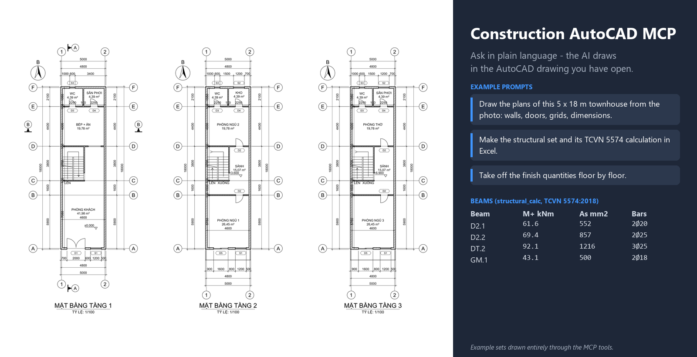

# AutoCAD MCP

[English](README.md) | **Tiếng Việt**

**AI triển khai hồ sơ bản vẽ xây dựng trong AutoCAD:**
- Kiến trúc (KT), kết cấu (KC) có tính toán sơ bộ theo TCVN, nội thất (NT), điện và cấp thoát nước, cùng từ một mặt bằng.
- Khối lượng do chính AutoCAD kiểm lại, bảng tính Excel sống, khung tên và xuất PDF.
- Bản vẽ tiếng Việt hoặc tiếng Anh.
- Đọc, dọn và sửa được cả bản vẽ của người khác.



AutoCAD MCP cho phép Claude làm việc trực tiếp trên bản vẽ đang mở trong AutoCAD. Việc chính của nó là triển khai bản vẽ: từ ảnh scan/ảnh chụp mặt bằng, bản phác tay, ảnh render hoặc mô hình 3D, Claude vẽ thành bản vẽ 2D hoàn chỉnh, đúng layer (tường giao nhau gọn với hatch vật liệu, cửa đi/cửa sổ cắt vào tường, cột, trục định vị có ký hiệu, cầu thang, phòng có diện tích đo từ tường, chuỗi kích thước, ký hiệu, khung tên và xuất PDF). Từ chính mặt bằng đó nó dựng mặt đứng, mặt cắt, vẽ chi tiết bê tông cốt thép (dầm, cột, móng) kèm bảng thống kê thép, bộ hồ sơ thiết kế nội thất (mặt bằng bố trí nội thất, mặt bằng lát sàn, mặt bằng trần đèn, triển khai mặt đứng từng vách, chi tiết đồ gỗ và bảng thống kê vật liệu hoàn thiện), cùng bộ hồ sơ điện và cấp thoát nước (mặt bằng chiếu sáng, ổ cắm có mạch điện, sơ đồ nguyên lý và trục đứng cấp điện, mặt bằng cấp nước, thoát nước, sơ đồ nguyên lý, bể tự hoại) kèm bảng tính và khối lượng. Ngoài ra nó đọc bản vẽ, bóc khối lượng theo layer/block và kiểm tra lỗi bản vẽ.

Cách hoạt động giống [SketchUp MCP](https://github.com/2ez4gcx/sketchup-mcp): một extension cho Claude Desktop (`.mcpb`, chạy trên Node.js có sẵn trong Claude Desktop) và một add-in nhỏ chạy bên trong AutoCAD (**ACAD MCP Bridge**, add-in .NET). Không cần cài Python hay Node.js.

Phiên bản: **1.4.0** - [tải tại Releases](https://github.com/2ez4gcx/autocad-mcp/releases/latest). Có trong [MCP Registry](https://registry.modelcontextprotocol.io/v0.1/servers?search=io.github.2ez4gcx/autocad-mcp) chính thức với tên `io.github.2ez4gcx/autocad-mcp`.

## Tính năng

81 tool. Chiều dài theo đơn vị bản vẽ (mm với bản vẽ hệ mét), diện tích m², góc độ (ngược chiều kim đồng hồ từ trục +X).

| Nhóm | Tool |
|---|---|
| Đọc & khối lượng | `ping`, `drawing_info`, `list_layers`, `list_blocks`, `query_entities`, `selection_info`, `quantity_takeoff`, `check_drawing`, `measure_model`, `verify_quantities`, `list_views`, `standardize_layers`, `read_plan`, `revision_cloud`, `describe_drawing`, `describe_folder`, `compare_drawings`, `check_annotations`, `list_texts` |
| Tiêu chuẩn | `setup_layers`, `setup_styles` |
| Vẽ & sửa | `draw_plan`, `draw_entities`, `define_block`, `transform_entities`, `stretch_entities`, `set_properties`, `replace_text`, `update_texts`, `convert_vietnamese_text`, `clean_drawing`, `delete_entities`, `select_entities`, `undo`, `purge_drawing` |
| Mặt đứng, mặt cắt & kết cấu | `draw_elevation`, `draw_section`, `draw_roof_plan`, `draw_door_schedule`, `draw_stair_detail`, `draw_finish_quantities`, `draw_structure_plan`, `draw_beam_schedule`, `draw_structure_notes`, `draw_structure_detail`, `rebar_schedule`, `structural_calc`, `draw_quantity_schedule` |
| Thiết kế nội thất | `draw_furniture_plan`, `draw_floor_finish_plan`, `draw_wall_finish_plan`, `draw_ceiling_plan`, `draw_interior_elevation`, `draw_joinery_detail`, `material_schedule`, `lighting_calc` |
| Điện & cấp thoát nước | `draw_electrical_plan`, `draw_electrical_diagram`, `electrical_calc`, `draw_plumbing_plan`, `draw_plumbing_diagram`, `plumbing_calc`, `draw_mep_notes` |
| Ảnh & nguồn 3D | `view_image`, `attach_image`, `manage_images`, `import_drawing`, `screenshot`, `set_view` |
| Khung tên & file | `create_layout`, `update_title_blocks`, `retitle_view`, `draw_cover_sheet`, `draw_drawing_list`, `export_pdf`, `save_drawing`, `open_drawing`, `close_drawing`, `new_drawing` |
| Lập trình | `run_lisp` |
| Cài đặt | `install_autocad_bridge` |

Điểm chính:

- **Hỏi trước khi giả định**: trước khi vẽ, Claude liệt kê những gì yêu cầu chưa nói rõ (kích thước không đọc được, cao độ, mái, vật liệu, nội thất, kích thước kết cấu...) kèm giá trị nó định dùng, bạn đồng ý hoặc sửa rồi mới vẽ. `draw_plan`, `draw_elevation`, `draw_section`, `draw_structure_detail` và các tool vẽ nội thất có `dry_run=true` để liệt kê các giá trị mặc định sẽ dùng mà chưa vẽ, và mỗi kết quả đều báo lại các giá trị đã tự giả định (`assumed`).
- **Cả mặt bằng trong một bước** (`draw_plan`): Claude mô tả mặt bằng bằng mm đọc được từ ảnh (trục tường và chiều dày, ô cửa theo tường và khoảng cách, cột, trục, phòng, cầu thang, cao độ, ký hiệu mặt cắt, hướng bắc), tool vẽ tất cả trong một bước Undo:
  - các đoạn tường được hợp khối nên chỗ giao chữ L, T, X luôn gọn; mỗi vật liệu một hatch (gạch, bê tông, block, gạch nhẹ, đá, đặc);
  - cửa đi (1 cánh, 2 cánh, trượt), cửa sổ, lỗ mở được cắt vào tường, có cánh, cung mở và nét kính;
  - cột được cắt khỏi tường và tô đặc; có thể đặt cột tại mọi giao điểm trục;
  - trục có ký hiệu hai đầu (1, 2, 3... theo phương ngang, A, B, C... theo phương dọc), chuỗi kích thước bên ngoài (ô cửa, khoảng trục, kích thước tổng) ở các cạnh bạn chọn;
  - **diện tích phòng được đo từ tường, không bao giờ gõ tay**: mỗi phòng chỉ cần một điểm bên trong; nhãn ghi tên và diện tích đo được (tên dài hơn bề rộng phòng tự xuống hai dòng, nhãn luôn nằm trong phòng, không đè lên tường), đường bao kín đặt trên layer `A-AREA` (không in) để bóc khối lượng; khoảng kín chưa đặt tên phòng cũng được báo lại.
- **Mặt đứng, mặt cắt dựng từ mặt bằng** (`draw_elevation`, `draw_section`): dùng chung mô tả với `draw_plan` nên luôn khớp với mặt bằng. Cao độ (sàn, sân, đỉnh tường, đầu cửa đi, bậu và đầu cửa sổ, móng) và mái (mái dốc hai mái theo hướng nóc bất kỳ, độ dốc, độ vươn, hoặc mái bằng có tường chắn; nhiều mái, ví dụ mái sảnh) chỉ khai báo một lần.
  - mặt đứng từ mọi phía: tường, cột gần nhất che phía sau, bỏ nét khuất, mái thể hiện phía diềm (sóng ngói) hoặc đầu hồi, cửa có khuôn, đường cốt nền và mặt đất, ký hiệu cao độ, chuỗi kích thước chiều cao, ký hiệu trục kèm khoảng trục, tên hình vẽ;
  - mặt cắt theo ký hiệu mặt cắt trên mặt bằng (hoặc đường cắt bất kỳ): sàn, mái, lanh tô và dầm dưới sàn tại mọi tường bị cắt tô đặc (poché, `beam_depth` mặc định 300), trần từng phòng ở đúng cao độ hoàn thiện có giật cấp và ty treo lên sàn, thẻ mã trần và mã sàn, cao độ ở cả hai bên có đường dóng ra từ công trình, tường bị cắt có hatch và lanh tô trên ô cửa đi qua, móng có bê tông lót, sàn và lớp đất đắp, sàn hiên ra tới cột, mái bị cắt, tường/cửa nhìn thấy phía sau, tên phòng, cao độ và trục;
  - chi tiết trang trí thấy trong ảnh (cửa sổ đầu hồi, ốp gỗ, chóp mái) thêm bằng `draw_entities` trên layer `A-ELEV`.
- **Năm bộ hồ sơ, năm file riêng**: Kiến trúc (KT), Kết cấu (KC), Nội thất (NT), Điện (Đ) và Cấp thoát nước (N) là năm bản vẽ riêng, như một văn phòng thiết kế phát hành.
  - Mỗi bộ được tạo bằng `new_drawing` từ cùng một mô tả mặt bằng.
  - Mỗi bộ có tờ bìa, danh mục bản vẽ riêng (`draw_drawing_list`, tờ KT-00 / KC-00 / NT-00 / Đ-00 / N-00), số tờ riêng và hạng mục riêng trên khung tên (KIẾN TRÚC, KẾT CẤU, NỘI THẤT, ĐIỆN, CẤP THOÁT NƯỚC).
  - Các công cụ kết cấu, nội thất, điện và cấp thoát nước làm việc được trong file không có mặt bằng kiến trúc: AutoCAD tính đường bao phòng từ mô tả mặt bằng mà không vẽ ra (`draw_plan rooms_only`).
  - Ví dụ: `examples/Nha-pho-5x18-KT.pdf`, `-KC.pdf`, `-NT.pdf`, `-DIEN.pdf`, `-CTN.pdf`.
- **Mặt bằng mái** (`draw_roof_plan`), cho mái bằng:
  - tường mái và tum của tầng trên cùng, có trục và kích thước;
  - mái tum (hatch), sân thượng;
  - phễu thu kèm mũi tên dốc i=2%, ống thoát nước mưa;
  - cao độ sân thượng, đỉnh tường mái và mái tum;
  - ghi chú chống thấm, láng vữa tạo dốc và ống thoát nước.
- **Tờ bìa** (`draw_cover_sheet`): "HỒ SƠ BẢN VẼ <bộ>", giai đoạn, công trình, hạng mục, chủ đầu tư, đơn vị thiết kế, tổng thầu, địa điểm, ngày; mỗi bộ mở đầu bằng tờ bìa và danh mục bản vẽ.
- **Bảng thống kê cửa đi, cửa sổ** (`draw_door_schedule`):
  - mỗi loại cửa (theo ký hiệu, loại và kích thước, trên mọi tầng) được vẽ mặt đứng với khung, cánh, chiều mở (nét đứt gặp nhau ở phía bản lề) và kính;
  - kích thước rộng, cao, cao bậu, ký hiệu và số lượng;
  - bảng: ký hiệu, loại, R x C, cao bậu, số lượng theo tầng, vật liệu.
- **Chi tiết cầu thang** (`draw_stair_detail`), cho thang chữ U:
  - mặt bằng thang từng loại tầng (tầng đầu, các tầng điển hình gộp lại, tầng đến) tỷ lệ 1/50, có tường xung quanh, đánh số bậc, kích thước vế thang / chiếu nghỉ / bề rộng (n x b), cao độ sàn và chiếu nghỉ, trục và ký hiệu mặt cắt;
  - mặt cắt 1-1 dọc vế thang: vế bị cắt với bản thang BTCT và chiếu nghỉ, vế nhìn thấy phía sau, sàn và tường bị cắt, tay vịn và thanh đứng, kích thước bậc (n x h) từng vế, chiều cao tầng và cao độ;
  - ghi chú cấu tạo bậc thang và chiếu nghỉ, kèm 2h + b;
  - chi tiết bậc thang, tay vịn tỷ lệ 1/20 (đá granite, vữa, bậc xây gạch, bản thang, lớp trát, tay vịn, thanh đứng), vẽ riêng: đặt chung một tờ bằng `create_layout views`.
- **Bảng tính kết cấu sơ bộ** (`structural_calc`), kỹ sư kết cấu có chứng chỉ hành nghề phải kiểm tra, tính lại và ký xác nhận:
  - tải trọng theo TCVN 2737:2023: cấu tạo sàn, hoạt tải theo phòng (phòng ở 1,5, sảnh và cầu thang 3, ban công 2 kN/m² …), tường ngăn, tường trên dầm đã trừ lỗ cửa, trọng lượng bản thân;
  - tải sàn truyền vào dầm (bản kê 4 cạnh hình thang / tam giác, bản dầm), dầm liên tục với hoạt tải đặt toàn bộ / nhịp lẻ / nhịp chẵn, mô men gối biên qL²/24;
  - tính cốt thép chịu uốn và cốt đai theo TCVN 5574:2018 (αm, ξ ≤ ξR, As, chọn thép; đai vùng gối và giữa nhịp): mô men theo tải tương đương, lực cắt và phản lực theo tải thực truyền; dầm gác lên dầm và cột cấy trên dầm là lực tập trung; thép đã tính chuyển sang `draw_beam_schedule`;
  - tải trọng cột từng tầng xuống móng; cột được chọn tiết diện theo tải (220x220, 220x300, 300x300 … với φ theo l0/h), móng đơn được chọn theo áp lực đất (cạnh móng, chiều cao theo chọc thủng, lưới thép theo uốn, tối đa bốn loại), có ghi chú khi các móng chồng lên nhau (dùng móng băng hoặc móng bè) hoặc nằm sát ranh đất; `draw_structure_plan` sau đó vẽ đúng các cột (C1, C2 …) và móng (M1, M2 …) này;
  - sàn (bản kê bốn cạnh theo Marcus, bản dầm), cầu thang và ban công công xôn cũng được tính thép: thép này đi vào bảng thống kê;
  - tờ bảng tính (vật liệu, tải trọng sàn, cấu tạo sàn, dầm, cột và móng, giả thiết) kèm ô xác nhận: người tính, kiểm tra, chủ trì kết cấu (họ tên, số chứng chỉ, chữ ký, ngày); xuất CSV cho Excel;
  - `xlsx_path`: file Excel bảng tính sống: số liệu nhập ở ô màu vàng (vật liệu, chiều dày và trọng lượng riêng các lớp, hệ số vượt tải, hoạt tải, áp lực đất, kích thước cột và móng, q, thép chọn), còn lại là công thức (g, p, M, αm, ξ, As, kiểm tra, bước đai, khả năng chịu lực cột, diện tích móng): sửa số liệu là bảng tự tính lại.
- **Hồ sơ điện** (`draw_electrical_plan`, `draw_electrical_diagram`, `electrical_calc`, `draw_mep_notes`), từ cùng mặt bằng:
  - mặt bằng chiếu sáng: đèn theo quy tắc trần của bộ nội thất, quạt hút WC, đèn tường ngoài trời; mỗi phòng một công tắc cạnh cửa chính (phía tay nắm, công tắc WC đặt ngoài cửa WC), mỗi nhóm đèn một hạt, công tắc 2 chiều ở cầu thang; dây của từng mạch và đường về tủ ghi tên mạch L1, L2...;
  - mặt bằng ổ cắm, điều hòa: ổ cắm theo loại phòng (đầu giường, bàn làm việc, vách TV, mặt bếp, ổ chống nước ở WC và sân), đầu chờ bếp từ, điều hòa treo tường chọn theo 600 BTU/m², bình nóng lạnh, máy bơm, ổ mạng, ổ TV về tủ mạng, công tơ ở mặt tiền;
  - mỗi tầng một tủ điện cạnh cầu thang (tủ tổng TĐ-T ở tầng 1); mỗi mạch tối đa 10 đèn hoặc 8 ổ cắm, mỗi điều hòa, bình nóng lạnh, bếp, bơm một mạch riêng; aptomat (MCB, RCBO 30mA) và dây Cu/PVC chọn theo dòng điện, chiều dài theo tuyến dây, kiểm tra sụt áp;
  - sơ đồ nguyên lý kèm bảng phân phối từng tủ, sơ đồ trục đứng, chi tiết tiếp địa, ghi chú chung và bảng ký hiệu;
  - `electrical_calc`: bảng tính phụ tải và bảng khối lượng (đèn, công tắc, ổ cắm, điều hòa, tủ điện và aptomat, dây theo tiết diện, ống luồn, tiếp địa), có ô ký xác nhận của kỹ sư điện, file CSV và file Excel sống (dòng điện, aptomat, dây, sụt áp là công thức).
- **Hồ sơ cấp thoát nước** (`draw_plumbing_plan`, `draw_plumbing_diagram`, `plumbing_calc`, `draw_mep_notes`):
  - hộp gen ở góc WC, thẳng hàng các tầng, chứa ống đứng thoát xí, thoát rửa và ống cấp;
  - mặt bằng cấp nước: đồng hồ, máy bơm lên bồn trên mái tum, mỗi tầng một nhánh cấp tự chảy bằng ống PPR (ống chính có tê rẽ tới từng thiết bị), nước nóng từ bình nóng lạnh của mỗi WC, mỗi nhánh một van khóa; thiết bị lấy theo mặt bằng nội thất, chưa có thì mặc định bồn cầu, sen, lavabo cho WC, chậu rửa cho bếp, máy giặt cho sân phơi;
  - mặt bằng thoát nước: thoát xí, thoát rửa, thoát mưa riêng bằng ống uPVC có đường kính và độ dốc, phễu thu sàn, ống đứng thoát mưa của mái và ban công, bể tự hoại 3 ngăn dưới sàn tầng 1, hố ga và ống ra cống chung;
  - sơ đồ nguyên lý cấp nước, thoát nước, chi tiết bể tự hoại và hố ga, mặt bằng chi tiết WC;
  - `plumbing_calc`: nhu cầu dùng nước nhà ở (đương lượng TCVN 4513:1988, q = 0,2 · N^(1/a) + K · N), đường kính ống đứng, bồn mái, cột áp tại vòi sen cao nhất so với mức tối thiểu 3 m (dưới 8 m thì khuyến nghị bơm tăng áp), lưu lượng mưa mỗi ống đứng (TCVN 4474:1987, Q = K F q5 / 10000, K = 2), dung tích bể tự hoại; bảng khối lượng ống theo hệ và đường kính, phụ kiện, thiết bị vệ sinh, thiết bị, có ô ký xác nhận, file CSV và Excel sống.
- **Bảng thống kê cốt thép và bảng tổng hợp khối lượng** (`draw_quantity_schedule`):
  - thống kê thép toàn bộ hồ sơ: móng, cột, giằng móng, dầm, sàn, cầu thang và ban công theo thép đã tính; tính nối chồng và neo, khối lượng bằng công thức trong bảng, tổng theo đường kính, tự chia trang;
  - bảng tổng hợp khối lượng vật tư có diễn giải (số bộ phận giống nhau × một bộ phận): đào móng và giằng móng, đắp trả, đất thừa; bê tông lót, bê tông và ván khuôn móng, cổ cột, giằng móng, bê tông nền và lớp tôn nền, cột từng tầng, dầm, sàn, cầu thang; cốt thép theo nhóm; tường xây theo chiều dày (m², m³) đã trừ cửa, lanh tô, bậc xây cầu thang; trát tường trong, ngoài, trát trần; xuất CSV cho Excel. Khoảng lưu không khi đào và bê tông nền là tùy chọn, giá trị giả định được liệt kê;
  - `xlsx_path`: toàn bộ file Excel kết cấu (bảng tính, thống kê thép có công thức khối lượng, khối lượng vật tư là công thức của phần diễn giải).
- **Khối lượng hoàn thiện kiến trúc** (`draw_finish_quantities`): lát nền theo loại gạch, ốp tường, len chân tường; bả matit, sơn tường trong, tường ngoài (các mặt tường không có phòng phía bên đó, chân tường, tường mái) và trần; trần thạch cao; chống thấm sàn vệ sinh, ban công, sân thượng; láng vữa tạo dốc và mái tum; đá granite bậc thang, lan can tay vịn cầu thang, lan can ban công; cửa đi, cửa sổ theo loại. Phòng và vật liệu lấy theo bộ nội thất. Ban công được tính gạch lát, chống thấm và sơn đáy sàn; tường quanh sân thượng tính theo chiều cao tường mái. Bảng có khối lượng từng tầng, xuất CSV và file Excel sống: khối lượng hoàn thiện là công thức lấy từ các sheet phòng, mặt ngoài và cửa, sửa kích thước hay chiều cao là bảng tự tính lại.
- **Khối lượng kiểm tra được** (`rules`, `verify_quantities`, `measure_model`): các bảng là tổng trên một mô hình của cái được xây, không bao giờ là diện tích phòng nhân với vật liệu:
  - hoàn thiện đo theo từng mặt: mặt tường theo chiều cao của tường phía sau nó, có lỗ cửa và má cửa; mặt đứng của trần giật cấp; mặt bậc, cổ bậc và len theo bậc của cầu thang; sàn dưới cửa; chống thấm quét lên tường giữa các cửa; đáy sàn và mái dốc; khi có kết cấu của `structural_calc` thì thêm hai mặt bên của dầm dưới trần bê tông sơn và mặt cột nhô khỏi tường;
  - bê tông đo theo khối đặc, chỗ các cấu kiện giao nhau chỉ thuộc về một cấu kiện, nên tổng các dòng đúng bằng thể tích đổ;
  - mỗi dòng có hai con số: khối lượng theo bộ quy tắc đo bóc và khối lượng hình học. Bộ mặc định theo Phụ lục VI Thông tư 13/2021/TT-BXD (lỗ dưới 0,25 m² không trừ khỏi xây và hoàn thiện, dưới 1 m² không trừ khỏi ván khuôn, lỗ rỗng dưới 0,1 m³ không trừ khỏi bê tông; nút cột – dầm tính cho dầm, phần trong chiều dày sàn tính cho sàn; ba số lẻ); `rules: "NET"` cho khối lượng hình học, `rules: {base: "PL6", void: {finish: 0.5}}` cho ngưỡng riêng của công ty;
  - mỗi bảng tự chạy các phép kiểm tra chéo (phòng + tường = mặt sàn tầng, mỗi cửa trừ trên hai mặt tường, tổng thể tích thực = hợp của các khối, đắp trả + phần chôn = đào...) và báo phép nào không đạt; file Excel liệt kê từng mặt, từng cấu kiện bằng công thức sống, kèm sheet kiểm tra;
  - `verify_quantities` dựng lại kết cấu thành khối đặc và các mặt hoàn thiện thành miền (region) bằng chính nhân hình học của AutoCAD rồi so sánh. Trên nhà mẫu: hợp của 166 cấu kiện là 86,146 m³ ở cả AutoCAD và bảng, 127 mặt đo được 1396,652 m² ở cả hai, mặt sàn từng tầng khớp ([`examples/Nha-pho-5x18-kiem-tra-khoi-luong.json`](examples/Nha-pho-5x18-kiem-tra-khoi-luong.json)). `measure_model` cho phép đo độc lập như vậy với bất kỳ khối lăng trụ và mặt nào. Phương pháp và nguồn: [`docs/quantity-model.vi.md`](docs/quantity-model.vi.md).
- **Chuẩn hóa layer bản vẽ của người khác** (`standardize_layers`): mỗi đối tượng được đưa về một bộ layer chuẩn (bộ A-/S-/E-/P- của công cụ hoặc chuẩn của công ty) theo đúng nó là gì: mục đích đọc từ tên layer (tiếng Việt có dấu hay không dấu, tiếng Anh, tiếng Trung, mã kiểu AIA, bỏ tiền tố xref đã bind), loại đối tượng khi tên không nói gì hoặc nói khác (kích thước luôn về layer kích thước), khối của đối tượng chèn (cửa, cao độ, ký hiệu trục, khung tên), và độ dày khi in (theo bảng .ctb của layout) cho đường nét trên layer đặt theo nét bút ("0.3", "net manh") hoặc layer 0. Màu, nét, độ dày gán riêng trở về ByLayer, trừ chỗ bản vẽ sẽ in khác đi (nét đậm vẫn đậm, nét đứt vẫn đứt; `keep_look: false` lấy độ dày của chuẩn). Layer rỗng bị purge; layer 0 trong khối, Defpoints và layer xref giữ nguyên. Luôn chạy thử trước (bảng chuyển layer theo từng layer, xuất CSV để sửa trong Excel rồi đưa lại bằng `mapping_csv`); `apply: true` làm trong một bước Undo và kiểm lại không mất đối tượng nào; `files` + `out_dir` làm nhiều bản vẽ một lúc, lưu thành bản mới (không bao giờ ghi đè file gốc). Trên 13 bản vẽ thật của các văn phòng khác: 1 487 layer còn 334, không mất đối tượng, tờ in không đổi. Phương pháp và giới hạn: [`docs/layer-standard.vi.md`](docs/layer-standard.vi.md).
- **Đọc mặt bằng của bản vẽ người khác** (`read_plan`): tường (hai mặt song song cách nhau một chiều dày tường, đầu tường kéo tới tường nó gặp), lỗ cửa (cửa đi khi có cung mở hay khối cửa, hai cánh khi có hai cung, cửa sổ khi có nét kính hay khối cửa sổ, kèm ký hiệu D1/S1), cột, trục kèm tên trục và tên phòng được đọc thành mô tả mặt bằng của `draw_plan`. Mặt bằng nằm trong khối hay xref đã bind vẫn đọc được; không đưa vùng thì công cụ tự tìm và xếp các vùng có tường theo cung cửa, tên phòng và tường hai phương (mặt cắt, mặt đứng cũng có nét song song). `preview` vẽ phần đọc được đè lên bản vẽ trên layer không in để so; `adopt` chuyển phần đọc được và kích thước cũ sang layer đóng băng X-OLD-PLAN (không xóa gì) rồi vẽ lại mặt bằng đúng chỗ, từ đó sửa và cập nhật tại chỗ như bản vẽ do công cụ vẽ. Trên nhà mẫu đọc đủ mọi tường, cửa, trục, phòng; trên bản vẽ văn phòng của đơn vị khác đọc được phần lớn vách trong và tên phòng, chưa đọc được vách kính mỏng bao ngoài. Phương pháp và giới hạn: [`docs/read-plan.vi.md`](docs/read-plan.vi.md).
- **Bộ hồ sơ tiếng Việt và tiếng Anh:**
  - Mặc định tiếng Việt: dấu phẩy thập phân, tên hình và ký hiệu theo thói quen TCVN.
  - `setup_layers` với `language: "en"` (hoặc tham số `language` của từng tool) vẽ cả bộ bằng tiếng Anh: tên hình và dòng tỉ lệ (SCALE 1:50), ghi chú, chú thích, bảng thống kê, file CSV và Excel, ghi chú đồ gỗ.
  - Ký hiệu từng bộ môn cũng đổi theo, kèm dấu chấm thập phân:
    - điện: tủ DB-1 và MDB, mạch AC/WH/CK/PU, Pd/Id/Kd thay cho Ptt/Itt/Kđt;
    - nước: ống CW, HW, SP, WP, RWP, VP, hộp gen SH, bể tự hoại ST, hố ga MH;
    - kết cấu: dầm B2./GB./RB., móng F1.
  - Tên phòng đặt bằng ngôn ngữ nào cũng được nhận: BEDROOM, KITCHEN, BATHROOM, OFFICE cũng như PHÒNG NGỦ, BẾP, WC, VĂN PHÒNG. So khớp nguyên từ: "ĂN" không bị đọc trong "VĂN PHÒNG".
  - Đã kiểm tra bằng cách vẽ năm bộ hồ sơ mẫu bằng tiếng Anh: không còn chữ tiếng Việt nào ngoài tên do người dùng nhập.
- **Các bước kiểm tra độ chính xác có sẵn:**
  - `attach_image` căn tỉ lệ ảnh scan hoặc ảnh chụp theo nhiều kích thước in trên ảnh, báo từng kích thước lệch bao nhiêu và ảnh có bị méo không. `dimension_chains` kiểm tra tổng các kích thước lẻ có bằng kích thước tổng trước khi vẽ.
  - `lighting_calc`:
    - đọc file quang học của từng đèn (IES LM-63 hoặc EULUMDAT) thay cho chùm sáng lý tưởng;
    - tính đồ đạc cao hơn mặt phẳng làm việc che sáng;
    - phần ánh sáng phản xạ tính theo mặt nhận sáng đầu tiên (cách tính cũ cho kết quả cao hơn 6 đến 8%).
  - `structural_calc` kiểm tra từng cột chịu nén lệch tâm theo từng tầng (TCVN 5574:2018 mục 8.1.2.3): mô men dầm không cân bằng tại cột, độ lệch tâm ngẫu nhiên, ảnh hưởng uốn dọc. Cột biên, cột góc không đạt được tăng tiết diện. Chưa xét mô men do gió, động đất: vẫn là tính toán sơ bộ.
  - Khối lượng: len chân tường quấn quanh cột lộ, mặt bên dầm dừng ở chỗ dầm khác giao vào, trần thạch cao khoét ở chỗ thang thẳng đi qua.
  - `material_schedule` với `compare_with` đặt bảng thống kê cạnh một bảng khác của cùng công trình theo mã (bảng bóc từ SketchUp MCP, bảng của kỹ sư dự toán) và liệt kê chênh lệch.
  - Một bộ nhận tên phòng dùng chung (khớp nguyên từ, tiếng Việt hoặc tiếng Anh) cho hoàn thiện, cửa, tải trọng, khối lượng, điện và nước.
  - `read_plan` nhận khe trống rộng cỡ cửa là cửa đi và báo rõ trong kết quả.
- **Thêm hình học:**
  - Tường cong: khai `bulges` cho tường (như polyline). Cung được dựng bằng các đoạn dây ngắn, lệch khỏi cung thật tối đa 5 mm, nên mặt đứng, diện tích phòng và khối lượng đều tính theo. Cửa trên tường cong nằm trên một đoạn thẳng riêng.
  - Mái hông (`type: "hip"`): mặt đứng từ mọi phía, mặt cắt ở vị trí bất kỳ, diện tích theo mặt dốc kèm chiều dài sống mái và nóc.
  - Thang chữ L (hai vế và chiếu nghỉ vuông) và thang xoắn: có trên mặt bằng và trong khối lượng (mặt bậc, cổ bậc, tay vịn, đáy thang, trừ sàn ở chân thang, khoét trần phía trên). Mặt cắt và chi tiết thang hiện chỉ vẽ thang chữ U.
- **Bộ nội thất, những điểm rút ra từ một dự án thật:**
  - Đồ nội thất: `tv_cabinet` nhận `tv: false` (chỉ tủ thấp, không có tivi). Có thêm loại `sideboard` (tủ credenza). Bàn trà, bàn ăn có thể tròn (`shape: "round"` hoặc `diameter`; bàn ăn tròn có ghế xếp quanh).
  - Chú thích và ghi chú của mặt bằng nội thất, sàn, tường, trần được đặt cạnh mặt bằng, ngoài tường, đường kích thước và bóng trục, ở chỗ bản vẽ còn trống (nếu không thì dưới, trái hoặc trên). `notes_at` để tự đặt; kết quả trả về vùng của khối này.
  - Bản copy mặt bằng nhận `dimensions` riêng (các phía, hoặc false) và `interior_dimensions` (mặc định tắt).
  - `draw_floor_finish_plan` nhận `zones`: vùng thảm lát âm trong sàn đá có mạch, mã và diện tích riêng, trừ khỏi diện tích phòng.
  - `draw_ceiling_plan` nhận `lights` do người thiết kế đặt (downlight, spot có hướng chiếu, đèn thanh, miệng gió khe, nắp thăm), đếm theo mã trong chú thích; `rooms[].ceiling.grid` vẽ trần lưới T.
  - `draw_interior_elevation` nhận `wall_finishes` (ví dụ một vách ốp kính sơn mặt sau, các vách khác sơn) và `titles`.
  - `setup_styles` và `draw_plan` giữ LTSCALE của bản vẽ đã có hình. Khoá lạ trong `heights` được báo. Lỗi ô cửa nêu tên ô.
  - `list_texts` / `update_texts` đọc và sửa được thuộc tính của ghi chú multileader (`handle:TAG`).
  - `export_pdf` báo rõ khi file PDF đang mở trong trình xem; `if_locked: "rename"` ghi ra tên khác.
  - `manage_images` gỡ, nạp lại, thay và dọn ảnh chèn. `retitle_view` đổi tên hình kèm gạch chân. `create_layout` nhận id của view thay cho cửa sổ. `update_title_blocks` ghi lần sửa vào khung tên mọi tờ.
- **Làm việc trên bản vẽ của người khác** (`describe_drawing`, `stretch_entities`, `replace_text`, `convert_vietnamese_text`, `compare_drawings`):
  - `describe_drawing` đọc bản đồ của bản vẽ: các tờ (layout và viewport của nó, hoặc khung vẽ trong model kể cả khung kéo dài; khổ giấy và tỷ lệ suy ra từ kích thước khung), khung tên, các hình trên từng tờ theo tên hình (mặt bằng, mặt đứng, mặt cắt, chi tiết, bảng... tiếng Việt, Anh, Trung; tên ghi hai thứ tiếng tính là một hình) kèm tầng, tỷ lệ và vùng model thu vừa với nét vẽ.
  - `stretch_entities` kéo giãn một phần bản vẽ tại chỗ như lệnh STRETCH: dời một bức tường thì mặt tường, hatch (cung giữ độ phồng), cửa và kích thước đi theo; chữ diện tích trong đường bao phòng được tính lại.
  - `replace_text` tìm và thay chữ trong text, mtext, thuộc tính khối, kích thước ghi đè, ô bảng và định nghĩa khối, có xem trước.
  - `convert_vietnamese_text` chuyển chữ gõ cho font cũ TCVN3 (.VnTime) và VNI (VNI-Times) sang Unicode, đổi kiểu chữ sang Arial; kiểu chữ dùng font tên khác (font SHX) được nhận theo nội dung chữ.
  - `compare_drawings` so bản vẽ với phiên bản cũ trên đĩa và khoanh mây chỗ khác.
  - `transform_entities`, `set_properties`, `delete_entities`, `draw_entities` cũng nhận `revision`: sửa tay đến đâu khoanh mây đến đó.
  - `check_annotations` tìm kích thước bị ghi đè số không đúng với số đo và chữ diện tích không khớp đường bao phòng; sửa khi được yêu cầu (khoanh mây với `revision`).
  - `list_texts` liệt kê chữ trên bản vẽ (chữ không trùng, ngôn ngữ, handle; xuất CSV). `update_texts` sửa nhiều chữ theo handle trong một bước: rà câu chữ hoặc dịch bản vẽ song ngữ.
  - `clean_drawing` xóa nét vẽ trùng, nét dài bằng 0, chữ rỗng và gộp nét chồng nhau (như OVERKILL), có xem trước.
  - `describe_folder` đọc mọi file DWG trong một thư mục mà không mở chúng, rồi lập danh mục các tờ (Excel hoặc CSV).
- **Khoanh mây chỗ sửa đổi** (`revision`, `revision_cloud`): mọi công cụ vẽ nhận `revision` (số lần sửa, hoặc `{no, note}`) cùng `update: true`. Hình cũ được so với hình mới từng đối tượng; chỗ thay đổi được khoanh mây trên layer A-ANNO-REVS kèm tam giác số lần sửa. Đường bao đổi một góc thì chỉ khoanh chỗ đỉnh dời đi, không khoanh cả tầng. Mây của một lần sửa là một view riêng. `revision_cloud` khoanh mây theo vùng, theo đối tượng (handle) hoặc theo điểm, dùng cho chỗ sửa bằng tay trên bản vẽ cũ. `create_layout` ghi `title_block.revisions` vào các dòng sửa đổi của khung tên từng tờ.
- **Sửa bản vẽ cũ thay vì vẽ lại** (`update`, `list_views`): mỗi thứ một công cụ vẽ ra là một hình (view), và chính bản vẽ lưu danh sách các hình cùng mô tả công trình đã dùng để vẽ:
  - mọi công cụ vẽ đều nhận `update: true`: hình cũ của nó (cùng tầng, cùng ký hiệu mặt cắt, cùng phòng...) bị xóa và hình mới được vẽ đúng chỗ cũ, trong một bước Undo, nên các tờ layout vẫn hiện đúng hình đó; hình nào lớn hơn hình cũ thì được báo để lập lại tờ;
  - đổi công trình bằng cách gọi `draw_plan` với mô tả đã sửa và `update: true`; kết quả liệt kê các hình còn vẽ theo mặt bằng cũ (`stale_views`): cập nhật lần lượt từng hình là cả bộ hồ sơ, kể cả bảng khối lượng, khớp lại;
  - `list_views` cho biết các hình trong bản vẽ kèm tham số đã dùng, và với `plan: true` trả về mô tả công trình đang lưu. Cả hai nằm trong file DWG, nên bản vẽ mở lại ở phiên khác, hay vài tuần sau, vẫn sửa được như vậy mà không phải mô tả lại ngôi nhà;
  - bản vẽ không do các công cụ này vẽ thì không có hình nào được ghi: sửa từng đối tượng (`query_entities`, `transform_entities`, `set_properties`, `delete_entities`, `draw_entities`).
- **Bộ kết cấu** (`draw_structure_plan`, `draw_beam_schedule`, `draw_structure_notes`):
  - `draw_structure_plan floor=foundation` vẽ mặt bằng móng: móng đơn M1 dưới cột (nét khuất), giằng móng GM dưới tường tầng 1, kích thước và cao độ đáy móng;
  - `draw_structure_plan` vẽ mặt bằng kết cấu từng sàn (tầng 2, 3 … và mái):
    - dầm theo tường chịu lực của tầng dưới (tường dưới 150 mm xây trên sàn), tên theo sàn (D2.1 …, DM.1 cho mái), có b x h và số lượng;
    - cột tại nút tường;
    - bề dày sàn, sàn vệ sinh và ban công hạ 50 (hatch), ô thang gạch chéo;
    - trục có ký hiệu và kích thước.

    Kích thước là sơ bộ (h = nhịp/12, làm tròn lên 50, trong khoảng 300-700) và được báo là giả định để kỹ sư kết cấu xác nhận.
  - `draw_beam_schedule` vẽ cho mỗi loại dầm mặt cắt GỐI và NHỊP, có cánh sàn, cao độ FL, thép và đai, tên "DẦM D2.1 (200x400) - SL: 02".
  - `draw_structure_notes` vẽ ghi chú chung dạng bảng:
    - vật liệu (B20 / B15 / B7,5, CB240-T / CB300-V);
    - lớp bê tông bảo vệ theo cấu kiện;
    - chiều dài neo và nối theo đường kính;
    - lanh tô điển hình theo nhịp;
    - các ghi chú đánh số.

    Mặc định theo TCVN 5574:2018, giá trị nào cũng thay được.
- **Chi tiết kết cấu** (`draw_structure_detail`, `rebar_schedule`): mặt cắt có thép chủ và cốt đai móc 135°, dầm nhiều nhịp (thép dưới, thép trên, thép mũ gối theo tỷ lệ nhịp, đai dày ở gối và thưa giữa nhịp, mặt cắt 1-1 và 2-2), móng đơn có lưới thép, thép chờ cột, đai và cao độ; số hiệu thép có đường dẫn, mỗi loại thanh khác nhau một số hiệu. Mỗi chi tiết trả về các dòng thống kê; `rebar_schedule` gộp thành bảng thống kê cốt thép (số thanh, tổng chiều dài, khối lượng d²/162 kg/m theo từng dòng, từng đường kính và tổng) dạng bảng trong bản vẽ và CSV. Kích thước và thép do kỹ sư kết cấu quyết định: tool vẽ, không tính toán, và cảnh báo khi thép không đủ khoảng hở.
- **Thiết kế nội thất** (dựng từ mặt bằng của `draw_plan`; mã vật liệu giống SketchUp MCP: FL sàn, SK len, WL tường, CL trần, JN đồ gỗ đóng tại chỗ, FN nội thất rời, SN thiết bị vệ sinh, EQ thiết bị, LT đèn, mỗi mã một quy cách):
  - `draw_furniture_plan`: bản sao mặt bằng tỷ lệ 1:50 với thư viện đồ nội thất (giường, tab đầu giường, tủ áo, sofa, bàn ghế, bàn làm việc, kệ tivi, tủ bếp dưới/trên có chậu rửa và bếp, máy hút mùi, tủ lạnh, máy giặt, bồn cầu, lavabo, khu tắm đứng, bồn tắm, tủ giày, kệ sách) đặt sát một vách của phòng theo khoảng cách, thẻ mã không đè nhau, tên phòng tự dời ra chỗ trống không đè đồ và cung mở cửa, ký hiệu hướng nhìn mặt đứng A-D;
  - `draw_floor_finish_plan`: ron gạch hoặc ván sàn đúng kích thước thật của từng phòng (gạch căn giữa phòng hoặc từ một điểm, ván lệch 1/3), không đè tên phòng, thẻ mã và bảng chú thích kèm diện tích từng loại sàn;
  - `draw_floor_finish_plan` thể hiện thêm các chi tiết cần cho thi công:
    - nẹp chuyển tiếp inox dưới cửa ở chỗ đổi vật liệu hoặc cao độ sàn;
    - ở khu vệ sinh và ngoài trời: phễu thu (đặt trong khu tắm nếu có), mũi tên dốc "i=1%", ghi chú sàn hạ 20 mm (vệ sinh) hoặc 50 mm (ngoài trời);
    - cách lát (LÁT TỪ TÂM);
  - `draw_wall_finish_plan`: mặt bằng hoàn thiện tường:
    - dải vật liệu chạy dọc mặt trong từng bức tường theo kiểu hoàn thiện (sơn: 1 nét; gạch ốp: 2 nét có vạch mạch gạch), ngắt ở cửa đi và cửa sổ;
    - dải gạch ốp bếp sau tủ bếp dưới;
    - mỗi phòng một thẻ mã, ghi chiều cao ốp;
    - bảng chú thích kèm diện tích từng loại vật liệu tường;
  - `draw_ceiling_plan`: trần giật cấp dọc tường có nét giật cấp và đèn LED hắt, downlight trong dải giật cấp (hoặc lưới đèn), đèn ốp trần hoặc đèn thả trên bàn ăn, thẻ trần (cao độ trên, mã dưới), bảng ký hiệu đèn kèm số lượng.
    - `mode=finish`: mặt bằng hoàn thiện trần (vật liệu, cao độ, kích thước dải giật cấp, bảng chú thích trần kèm diện tích; không có đèn);
    - `mode=lighting`: mặt bằng bố trí đèn (đèn và bảng ký hiệu; không có thẻ cao độ);
  - mỗi mặt bằng nội thất có khối GHI CHÚ chung: đơn vị, kiểm tra kích thước thực tế, duyệt mẫu vật liệu. Thêm theo từng loại mặt bằng: mạch gạch và độ dốc sàn; lớp sơn, lớp ốp tường; tấm trần và lỗ thăm trần; định vị đèn. Có thể thay bằng ghi chú của bạn;
  - `draw_interior_elevation`: triển khai từng vách của phòng nhìn từ trong: tường, sàn, trần bị cắt (cả dải giật cấp), cửa đi, cửa sổ của vách, đồ gỗ và nội thất sát vách (hình chiếu đứng) và ở góc phòng (hình chiếu cạnh) là block (mỗi loại, kích thước, hướng nhìn một block `NT_MD_...` / `NT_MB_...`) có wipeout dưới đường bao để đồ phía trước che đồ phía sau, ron gạch ốp, gạch ốp bếp, len chân tường, chuỗi kích thước và ghi chú vật liệu có đường dẫn;
  - `draw_joinery_detail`: tủ bếp (tủ dưới có cánh, ngăn kéo, khoang chậu; tủ trên theo từng đoạn, máy hút mùi, gạch ốp) hoặc tủ áo: mặt đứng 1:10 với các mô-đun, chiều mở cánh, tay nắm, mặt cắt 1-1 qua thùng tủ với chiều dày ván và ghi chú vật liệu; lấy thẳng từ tủ đã đặt trên mặt bằng. `kind: "display"` vẽ tủ trưng bày dạng hộc cho showroom, phòng trưng bày:
    - các hộc nằm giữa các vách đứng phủ veneer;
    - mỗi hộc có chân lùi, tủ đế cánh mở nhấn, mặt kệ trưng bày, tranh hoặc bảng đục lỗ, đợt trên có LED dây, bảng tiêu đề ghi tên hộc;
    - phía trên có đố trên và hộp trần thạch cao;
    - mặt đứng 1:30 có ghi chú vật liệu và chuỗi kích thước, mặt cắt 1-1 tỉ lệ 1:10 đặt bên cạnh;
  - `lighting_calc`: kiểm tra độ rọi của các đèn trên mặt bằng trần theo TCVN 7114-1:2008 (tương đương ISO 8995-1).
    - Mỗi đèn là một nguồn điểm có góc chiếu. Thông số quang mặc định theo loại đèn; có thể khai lm, góc chiếu, W theo mã đèn hoặc cho từng đèn.
    - Tính ánh sáng trực tiếp trên lưới điểm của mặt phẳng làm việc từng phòng, cộng phần phản xạ.
    - Ra Em, Emin, Emax, U0 so với yêu cầu theo công năng phòng. Công năng nhận từ tên phòng: văn phòng 500 lx, phòng họp 500, lễ tân 300, showroom 300, hành lang 100...
    - Kèm công suất, mật độ công suất chiếu sáng (W/m²) và gợi ý sửa khi phòng không đạt.
    - Tính được trên mặt đứng, ví dụ vách trưng bày. Xuất CSV và vẽ bảng vào bản vẽ.
    - Bản vẽ mở lại ở phiên sau vẫn đọc được đèn của mặt bằng trần lưu trong bản vẽ;
  - `material_schedule`: sàn và trần theo m², len theo m (trừ cửa đi), tường theo m² từng mặt (trừ cửa và phần ốp bếp theo bộ quy tắc, cộng má cửa; cùng các mặt với bảng kiến trúc), nội thất, đồ gỗ, thiết bị vệ sinh, thiết bị, đèn theo số lượng, mỗi mã một dòng kèm phòng; bảng trong bản vẽ và CSV.
  Vật liệu mặc định theo loại phòng (phòng khô gạch porcelain 600x600, sơn nước, trần thạch cao giật cấp; WC gạch chống trơn, gạch ốp đến trần, trần chống ẩm; sân không trần) và mỗi kết quả đều liệt kê các giá trị đã tự giả định.
- **Nhà nhiều tầng** (`draw_plan` với `floors`): mỗi tầng có tường riêng (hoặc giữ tường tầng dưới), cửa, cầu thang, ban công, phòng và mái riêng. Mặc định tầng 1 cao 3600, các tầng trên 3300, sàn dày 120. Tường mái được chép từ tường tầng dưới với chiều cao riêng. Thang chữ U ghi LÊN ở tầng 1, LÊN/XUỐNG ở tầng giữa, XUỐNG ở tầng trên cùng. Ban công có mép sàn và lan can.
  Mặt bằng các tầng đặt cạnh nhau. Mặt đứng và mặt cắt chồng đủ các tầng: cao độ từng tầng và tường mái, lan can ban công, lỗ sàn ô thang, thang cắt dọc vế. Các công cụ nội thất nhận `floor`.
- **Block, field và multileader, không chỉ là nét vẽ**:
  - cửa đi, cửa sổ, cửa lùa là block, mỗi kích thước một block (`MCP_CUA_DI_900`, `MCP_CUA_DI_2C_1400`, `MCP_CUA_SO_1200_220`), chèn xoay hoặc lật theo hướng mở, có thuộc tính mã, loại, chiều rộng;
  - đồ nội thất và thiết bị vệ sinh là block theo loại và kích thước (`NT_<mã>_<loại>_<rộng>x<sâu>`, thuộc tính mã, tên, kích thước);
  - đèn (`MCP_DEN_*`), thẻ mã, thẻ trần, ký hiệu trục, cao độ, mặt cắt, hướng bắc, ký hiệu hướng nhìn mặt đứng nội thất, số hiệu thép và khung tên cũng là block, giá trị là thuộc tính. `quantity_takeoff group_by=block` đếm được kèm giá trị, sửa bằng ATTEDIT hoặc bảng Properties.

  Block được định nghĩa ở lần dùng đầu tiên. API AutoCAD không cho tạo dynamic block, nên mỗi kích thước là một định nghĩa riêng.
  Nhãn phòng ghi diện tích bằng field liên kết với đường bao `A-AREA` của phòng: kéo đường bao rồi REGEN hoặc UPDATEFIELD.
  Ghi chú vật liệu ở mặt đứng nội thất:
  - là multileader mà nội dung là block thẻ: mã đóng khung, mô tả ngắn bên dưới;
  - xếp một hàng phía trên mặt đứng, riêng sàn và len chân tường đặt một hàng bên dưới;
  - đường dẫn nét đứt, theo đúng thứ tự đối tượng nên không đường nào cắt nhau.

  Chi tiết đồ gỗ vẫn dùng cột multileader chữ.
  Thẻ đồ nội thất và cửa hình lục giác, thẻ vật liệu hình chữ nhật. Tên mỗi hình vẽ được gạch chân, kèm "TỶ LỆ: 1/50".
  Bảng thống kê vật liệu hiện block ký hiệu của đồ và đèn cạnh mã.
- **Layer chuyên nghiệp** (`setup_layers`): bộ layer kiến trúc kiểu AIA/NCS với nét in cho máy in đen trắng và mô tả tiếng Việt hoặc tiếng Anh: `S-GRID` (CENTER), `S-COLS`, `A-WALL` (0.5 mm), `A-WALL-PATT`, `A-DOOR`, `A-GLAZ`, `A-OPEN`, `A-FLOR-STRS`, `A-FURN`, `A-FLOR-FIXT`, `A-AREA` (không in), `A-ANNO-ROOM`, `A-ANNO-TEXT`, `A-ANNO-DIMS`, `A-ANNO-SYMB`, `A-ANNO-TTLB`, `A-ANNO-NOTE`, `A-ELEV`, `A-SECT`, `A-FLOR-CASE`, `A-CLNG`, `E-LITE`, `A-DETL`, `S-CONC`, `S-REBR`, `S-REBR-STIR`, `X-IMAGE` (không in)...; `standard="mep"` thêm các layer điện, nước (`E-LITE-SWCH`, `E-POWR`, `E-POWR-WIRE`, `E-COMM`, `P-DOMW-CWTR`, `P-DOMW-HWTR`, `P-SANR-SOIL`, `P-SANR-WAST`, `P-STRM`, `P-EQPM`...). Nếu bản vẽ đã có hệ layer riêng thì làm theo hệ đó (`draw_plan` nhận bảng đối chiếu vai trò -> tên layer).
- **Style theo tỷ lệ in** (`setup_styles`): đơn vị mm, kiểu chữ TrueType `MCP-ARIAL` (tiếng Việt không bao giờ ra dấu `?`), kiểu kích thước `MCP-1-<tỷ lệ>` với gạch xiên kiến trúc, chữ nằm trên đường kích thước, kiểu leader, chữ trong bảng và LTSCALE.
- **Làm việc từ ảnh**: `view_image` cho Claude xem một file ảnh, có thể cắt phóng to một vùng (để đọc số kích thước) và lưới tọa độ pixel; `attach_image` chèn ảnh vào bản vẽ làm nền mờ trên layer `X-IMAGE`, hiệu chỉnh tỷ lệ bằng hai pixel của một kích thước đã biết và đặt đúng một điểm (ví dụ giao trục A-1); `draw_entities` nhận tọa độ pixel của ảnh (`image_handle`) để đồ lại; `screenshot` kết xuất bản vẽ ngầm (nền trắng, không đổi màn hình của bạn) để Claude so với ảnh gốc.
- **Từ mô hình 3D**: đọc kích thước trong mô hình (ví dụ bằng SketchUp MCP) rồi vẽ lại bằng `draw_plan`, hoặc `import_drawing` một file DWG/DXF 2D xuất ra (mặt bằng, mặt cắt, mặt đứng) với tiền tố layer, rồi làm sạch và ghi chú.
- **Mọi loại đối tượng** (`draw_entities`): line, polyline có cung, hình chữ nhật, tròn, cung, ellipse, spline, điểm, text và mtext, hatch (có đảo), kích thước thẳng/xiên/góc/bán kính/đường kính, chuỗi kích thước kèm kích thước tổng, multileader, block có thuộc tính (cả từ file DWG), bảng. Một lô là một bước Undo; nếu một đối tượng sai thì không vẽ gì và lỗi chỉ rõ đối tượng nào.
- **Sửa** theo handle: di chuyển, sao chép (lặp), xoay, tỷ lệ, đối xứng, mảng chữ nhật/tròn, offset (về phía một điểm hoặc hai bên), phá khối (giữ giá trị thuộc tính); đổi thuộc tính, nội dung chữ, giá trị attribute.
- **Khối lượng** (`quantity_takeoff`): theo layer, block hoặc loại: số lượng, chiều dài (m), diện tích đường bao kín (m²), diện tích hatch (m²), số block kèm thống kê giá trị thuộc tính; xuất CSV cho Excel (`csv_format=semicolon` cho Excel cài định dạng Việt Nam/châu Âu: dấu `;` và phẩy thập phân).
- **Kiểm tra bản vẽ** (`check_drawing`): đối tượng trùng chồng (làm khối lượng gấp đôi), polyline trông kín nhưng chưa kín, đường bao hở trên layer diện tích, chữ tiếng Việt dùng font SHX (ra dấu `?`), thiếu font, xref/ảnh mất đường dẫn, đối tượng trên Defpoints, kích thước bị gõ đè số, đối tượng nằm quá xa, đối tượng trên layer 0, màu/nét/độ dày không ByLayer, layer không theo chuẩn đặt tên.
- **Field**:
  - diện tích phòng là field của đường bao phòng;
  - trong bảng thống kê vật liệu, khối lượng sàn và trần là field công thức, cộng diện tích các đường bao phòng;
  - các cột tổng của bảng thống kê thép (số thanh, chiều dài, trọng lượng từng dòng, theo đường kính, tổng cộng) là công thức của bảng: sửa số thanh hay chiều dài ngay trong bảng thì trọng lượng tự tính lại;
  - tỷ lệ trên khung tên là field của tỷ lệ viewport, ký hiệu bản vẽ là field của tên layout.

  Số thập phân dùng dấu phẩy.
- **Khung tên** (`create_layout`, `export_pdf`): layout khổ A0-A4 với `DWG To PDF.pc3` và `monochrome.ctb`, khung bản vẽ theo lề ISO/TCVN (lề trái 20 mm).
  - Khổ A3-A0 nằm ngang dùng khung tên dải dọc như hồ sơ thi công ở Việt Nam, gồm: bảng sửa đổi, ghi chú, chủ đầu tư, dự án, hạng mục, tư vấn thiết kế, chủ nhiệm, chủ trì, thiết kế, kiểm tra, tên bản vẽ, số hợp đồng, phiên bản, giai đoạn, ký hiệu bản vẽ, tỷ lệ, ngày. Dọc chân tờ có dòng ghi chú chung.
  - `views` đặt nhiều khung nhìn trên một tờ, mỗi khung một vùng model với tỷ lệ riêng (mặt bằng 1/100 kèm chi tiết 1/25, ba mặt bằng tầng cạnh nhau): xếp theo hàng, thẳng chân, canh giữa vùng vẽ; ô tỷ lệ của khung tên ghi "NHƯ HÌNH" khi các tỷ lệ khác nhau.
  - `title_block.style=bottom` cho khung tên 180 mm ở góc dưới, dùng cho khổ A4 và khổ đứng.
  - Cả hai đều là block có thuộc tính.
  - Khung nhìn khóa ở tỷ lệ chuẩn tự chọn cho vừa, đặt phía trên hoặc bên trái khung tên, chỗ nào chứa vừa hình vẽ (cảnh báo nếu tỷ lệ đã chọn làm cắt mất hình). `export_pdf` in các layout ra một file PDF nhiều trang (layout khác khổ giấy thì mỗi khổ một file, ví dụ `bo_A3.pdf`, `bo_A1.pdf`), hoặc in một vùng model space theo tỷ lệ.
- **Xuất file** (`save_drawing`, `screenshot save_path`): DWG 2018/2013/2010/2007/2004/2000 và DXF; `copy=true` (mặc định khi lưu bản cũ hoặc DXF) ghi một bản sao để gửi đi, bản vẽ đang mở giữ nguyên, ngược lại là Save As; ảnh PNG của bản vẽ tới 4096 px.
- **`run_lisp`**: khi không có tool phù hợp, Claude chạy AutoLISP (kết quả trả về dạng JSON) trong một nhóm Undo. Code không ghi ra đĩa nên AutoCAD không hỏi bảo mật (SECURELOAD).
- **Mỗi lần sửa bản vẽ là một bước Undo** (`MCP_<TÊN TOOL>` trong danh sách Undo của AutoCAD).
- **Lệnh trong AutoCAD**: `MCPSTATUS`, `MCPSTART`, `MCPSTOP`, `MCPPORT`, `MCPLOG`.

## Cách hoạt động

```
Claude Desktop
    |  MCP qua stdio
    v
autocad-mcp-1.4.0.mcpb        server MCP Node.js, chạy trên Node có sẵn trong Claude Desktop
    |  mỗi lệnh một yêu cầu JSON, TCP 127.0.0.1:9877 (chỉ trong máy)
    v
ACAD MCP Bridge               add-in .NET trong AutoCAD (bundle tự nạp), chạy lệnh trên luồng chính của AutoCAD
    |  AutoCAD .NET API
    v
bản vẽ đang mở
```

Bridge chạy bên trong AutoCAD (không điều khiển qua COM từ bên ngoài): mỗi lệnh chạy trên luồng chính trong một lần khóa tài liệu, nhanh với bản vẽ lớn, an toàn, và mỗi lệnh là một bước Undo.

## Yêu cầu

- **Claude Desktop** (bản mới, có *Settings > Extensions*).
- **AutoCAD 2021, 2022, 2023 hoặc 2024** bản đầy đủ (hoặc bản chuyên ngành như AutoCAD Architecture; **không dùng được AutoCAD LT** vì LT không nạp add-in .NET) trên **Windows 10/11**. Đã thử trên AutoCAD 2024. AutoCAD 2025 trở đi chạy .NET 8, cần bridge build riêng (chưa có).
- Chỉ khi tự build: Node.js 18+, trình biên dịch C# của Visual Studio Build Tools và AutoCAD 2021-2024.

## Cài đặt

1. **Cài extension vào Claude Desktop**: tải `autocad-mcp-1.4.0.mcpb` và `AcadMcpBridge-1.4.0.bundle.zip` ở [bản phát hành mới nhất](https://github.com/2ez4gcx/autocad-mcp/releases/latest), rồi vào *Settings > Extensions*, kéo thả file `.mcpb` vào cửa sổ (hoặc *Advanced settings > Install Extension...*), bấm *Install*. Bản build chưa ký số nên Claude Desktop có thể cảnh báo. Các bản 1.2.1-1.3.0 mang tên *Construction AutoCAD MCP*: nếu extension đó đang cài, gỡ nó ở *Settings > Extensions* để tool không bị liệt kê hai lần.
2. **Cài bridge vào AutoCAD**: trong một cuộc trò chuyện mới, nhờ Claude *"Cài ACAD MCP Bridge vào AutoCAD"* (tool `install_autocad_bridge`). Tool chép `AcadMcpBridge.bundle` vào `%APPDATA%\Autodesk\ApplicationPlugins`, AutoCAD tự nạp khi khởi động. Cài tay: giải nén `AcadMcpBridge-1.4.0.bundle.zip` vào thư mục đó.
3. **Khởi động lại AutoCAD.** Add-in chưa được ký số: khi AutoCAD hỏi về `AcadMcpBridge-1.4.0-<hash>.dll`, chọn **Always Load**. Mỗi bản bridge mới là một file mới nên sau khi cập nhật AutoCAD sẽ hỏi lại một lần. (Muốn không bao giờ bị hỏi, có thể thêm thư mục bundle vào *Options > Files > Trusted Locations* nếu chính sách IT cho phép.) Gõ `MCPSTATUS` trong AutoCAD, phải thấy `ACAD MCP Bridge v1.4.0: RUNNING on 127.0.0.1:9877`. Sau đó nhờ Claude *"Ping AutoCAD"*.

Tùy chọn ở *Settings > Extensions > AutoCAD MCP > Configure*: cổng bridge (mặc định 9877; nếu đổi thì gõ `MCPPORT` trong AutoCAD cho khớp) và thời gian chờ mỗi lệnh (mặc định 120 giây).

Cập nhật: cài `.mcpb` mới, nhờ Claude cài lại bridge, khởi động lại AutoCAD.

## Một phiên làm việc điển hình: vẽ mặt bằng từ ảnh

> Đây là ảnh scan mặt bằng tầng 1 (D:/DuAn/scan.jpg). Vẽ lại trong AutoCAD tỷ lệ 1:100 với layer chuẩn, đầy đủ kích thước và diện tích phòng, rồi dàn trang A3 và xuất PDF.

Claude sẽ: xem ảnh (`view_image`, phóng to vùng có số kích thước), tạo layer và style, chèn ảnh làm nền đã hiệu chỉnh tỷ lệ, vẽ mặt bằng bằng `draw_plan`, thêm nội thất, thiết bị vệ sinh, ghi chú bằng `draw_entities`, so sánh bằng `screenshot`, sửa chỗ khác biệt, chạy `check_drawing`, tạo layout và PDF.

Năm bộ hồ sơ nhà phố 5x18 m, 3 tầng + tum, mỗi bộ một bản vẽ riêng như văn phòng thiết kế phát hành:
- kiến trúc [`examples/Nha-pho-5x18-KT.pdf`](examples/Nha-pho-5x18-KT.pdf): bìa, danh mục, mặt bằng, mặt bằng mái, mặt đứng, mặt cắt, chi tiết cầu thang, bảng thống kê cửa, bảng khối lượng hoàn thiện (cả dạng [Excel](examples/Nha-pho-5x18-KT-khoi-luong-hoan-thien.xlsx));
- kết cấu [`examples/Nha-pho-5x18-KC.pdf`](examples/Nha-pho-5x18-KC.pdf): bìa, danh mục, ghi chú chung, mặt bằng móng với các móng đơn đã tính và chi tiết từng loại móng, mặt bằng kết cấu sàn tầng 2, tầng 3, tum, mái, bảng mặt cắt dầm, bảng tính sơ bộ (giả thiết áp lực đất 250 kPa), bảng thống kê cốt thép và bảng tổng hợp khối lượng (cả dạng [Excel](examples/Nha-pho-5x18-KC-bang-tinh.xlsx));
- nội thất [`examples/Nha-pho-5x18-NT.pdf`](examples/Nha-pho-5x18-NT.pdf): danh mục, bố trí nội thất, hoàn thiện sàn, tường, trần, bố trí đèn, mặt đứng nội thất, bảng vật liệu;
- điện [`examples/Nha-pho-5x18-DIEN.pdf`](examples/Nha-pho-5x18-DIEN.pdf): bìa, danh mục, ghi chú chung và ký hiệu, mặt bằng chiếu sáng và ổ cắm các tầng, sơ đồ nguyên lý kèm bảng phân phối tủ điện, sơ đồ trục đứng và chi tiết tiếp địa, bảng tính phụ tải và khối lượng (bảng tính cả dạng [Excel](examples/Nha-pho-5x18-DIEN-bang-tinh.xlsx));
- cấp thoát nước [`examples/Nha-pho-5x18-CTN.pdf`](examples/Nha-pho-5x18-CTN.pdf): bìa, danh mục, ghi chú chung và ký hiệu, mặt bằng cấp nước và thoát nước các tầng, sơ đồ nguyên lý, chi tiết bể tự hoại, hố ga và khu vệ sinh, bảng tính và khối lượng (cả dạng [Excel](examples/Nha-pho-5x18-CTN-bang-tinh.xlsx)).

File DWG nằm cùng thư mục; [`examples/Nha-pho-5x18-kiem-tra-khoi-luong.json`](examples/Nha-pho-5x18-kiem-tra-khoi-luong.json) là kết quả `verify_quantities` của ngôi nhà này: các bảng khối lượng so với số đo của chính AutoCAD.

Một bộ hồ sơ hoàn chỉnh từ một ảnh (không kèm ảnh gốc): [`examples/Nha-6x15-ho-so.pdf`](examples/Nha-6x15-ho-so.pdf) (6 tờ A3: mặt bằng, bốn mặt đứng, mặt cắt A-A và B-B tỷ lệ 1:100, dầm, cột, móng và bảng thống kê thép tỷ lệ 1:25), bộ nội thất [`examples/Nha-6x15-noi-that.pdf`](examples/Nha-6x15-noi-that.pdf) (10 tờ: mặt bằng bố trí nội thất, lát sàn, trần đèn 1:50, triển khai mặt đứng phòng ngủ, bếp, WC 1:30, chi tiết tủ bếp và tủ áo 1:10, bảng vật liệu hoàn thiện; CSV [`examples/Nha-6x15-vat-lieu.csv`](examples/Nha-6x15-vat-lieu.csv)), tất cả trong bản vẽ [`examples/Nha-6x15-ho-so.dwg`](examples/Nha-6x15-ho-so.dwg).

Thêm câu lệnh mẫu: [`mcpb/release-docs/SAMPLE_PROMPTS.md`](mcpb/release-docs/SAMPLE_PROMPTS.md).

## Xử lý sự cố

| Hiện tượng | Cách xử lý |
|---|---|
| `Cannot connect to AutoCAD` | Gõ `MCPSTATUS` trong AutoCAD. Báo lệnh không tồn tại: cài bridge rồi khởi động lại AutoCAD (và cho phép DLL). STOPPED: gõ `MCPSTART`. Cổng 9877 bị chương trình khác dùng: `MCPPORT`. |
| AutoCAD hỏi về `AcadMcpBridge-...dll` nhưng bridge không chạy | Đã chọn *Do Not Load*: AutoCAD nhớ lựa chọn đó trong cả phiên. Khởi động lại AutoCAD và chọn *Always Load*. |
| Mỗi lần xuất PDF mất khoảng 30 giây | Bản thân AutoCAD in chậm khi máy in mặc định của Windows là máy in mạng không phản hồi (lệnh PLOT gốc cũng chậm như vậy). Chọn máy in mặc định là máy cục bộ (ví dụ *Microsoft Print to PDF*) hoặc ẩn máy in hệ thống trong AutoCAD (*Options > Plot and Publish*). |
| `install_autocad_bridge` báo lỗi | Có AutoCAD khác đang giữ file: đóng hết AutoCAD rồi chạy lại. |

## Bảo mật

Bridge chỉ nghe trên 127.0.0.1, không có xác thực (giống các bridge MCP cục bộ khác): mọi chương trình chạy dưới tài khoản Windows của bạn đều gửi lệnh được, kể cả `run_lisp`. Gõ `MCPSTOP` trong AutoCAD để tắt khi không dùng.

## Tự build

```bat
cd mcpb
npm ci
npm run build    :: biên dịch bridge, đóng gói server, tạo dist/autocad-mcp-<version>.mcpb
npm test         :: test bộ máy vẽ mặt bằng + smoke test server
```

## Giấy phép

MIT, xem [LICENSE](LICENSE).
